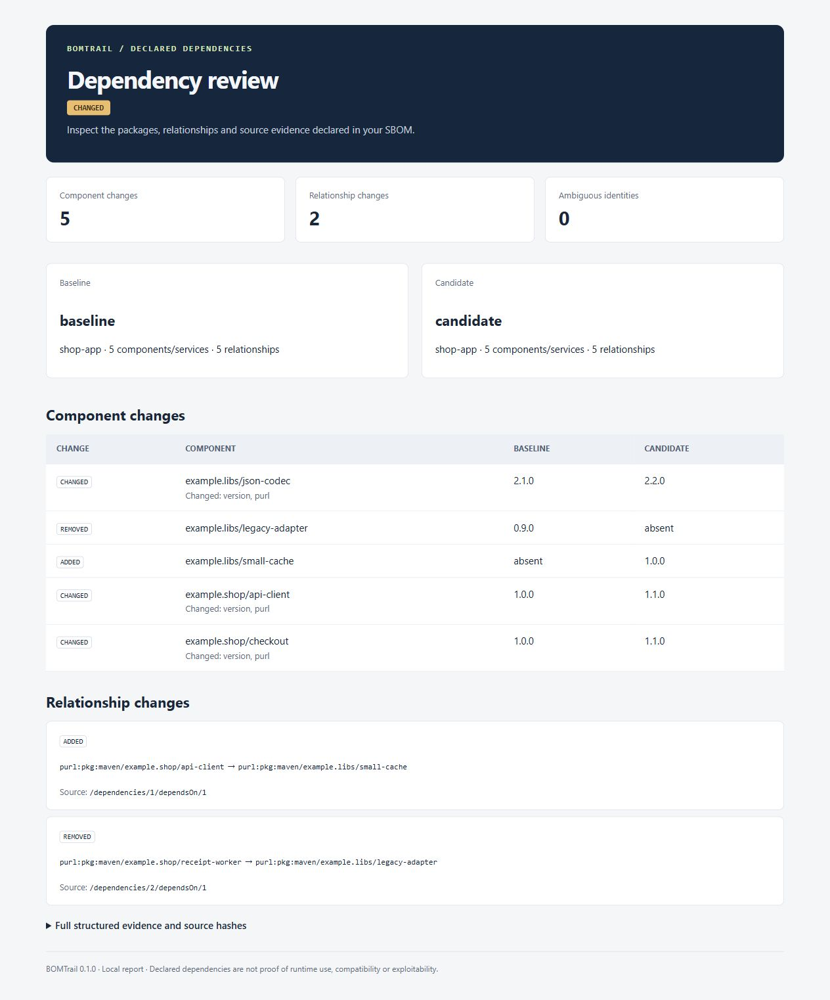

# BOMTrail

Trace declared software dependencies from a CycloneDX SBOM. Find why a package is present, inspect its dependents, and review what changed between two snapshots.

[](https://github.com/Almeida96/bomtrail/actions/workflows/ci.yml)
[](https://kotlinlang.org/)
[](LICENSE)

BOMTrail is a Kotlin command-line tool with a read-only MCP server. It stores imported SBOMs as immutable local snapshots, builds their declared dependency graph, and returns source pointers with its findings. An agent can search a package, follow its dependency path, inspect reverse dependencies, and compare releases without running the analyzed project.



## Try the demo

Install Java 21 or later, extract [the release ZIP](https://github.com/Almeida96/bomtrail/releases/latest), and run from the extracted directory:

```sh
bin/bomtrail demo --dir demo-output
```

Windows PowerShell:

```powershell
.\bin\bomtrail.bat demo --dir demo-output
```

The destination directory must be new. Open `demo-output/comparison.html`. The example replaces a legacy dependency with a cache library and updates three component versions. It also produces a shortest dependency path and the reverse dependents of a shared codec. All example packages are synthetic; they are not vulnerability or benchmark data.

After installation, the application runs offline. No model account, database server or API key is needed.

## Investigate an SBOM

Export a CycloneDX JSON SBOM from your build tooling, then import it. The commands below assume the distribution's `bin` directory is on `PATH`; use `bomtrail.bat` on Windows.

```sh
bomtrail import --db boms.db --file release-a.json --name release-a --project checkout
bomtrail summary --db boms.db --snapshot release-a
bomtrail components --db boms.db --snapshot release-a --query jackson
```

Use the returned `ref` to inspect relationships. References come from the supplied SBOM; these command placeholders must be replaced with its actual values:

```sh
bomtrail inspect --db boms.db --snapshot release-a --ref PACKAGE_REF
bomtrail path --db boms.db --snapshot release-a --from APPLICATION_REF --to PACKAGE_REF
bomtrail impact --db boms.db --snapshot release-a --ref PACKAGE_REF
```

`path` finds one shortest path through known, declared edges. Omit `--from` to use `metadata.component` when available. `impact` walks the graph backwards and returns direct and transitive dependents with distances and bounded witness paths. Both operations handle cycles. Inventory and impact results are paginated.

Each edge points to its original `dependencies/.../dependsOn/...` entry. A nested component is treated as containment, not automatically as a dependency.

## Compare releases

```sh
bomtrail import --db boms.db --file release-b.json --name release-b --project checkout
bomtrail compare --db boms.db --baseline release-a --candidate release-b --format html --out review.html
```

Components match by a version-free package URL that retains qualifiers and subpath. Without a PURL, matching uses component/service kind, type, group and name. Duplicate identities are reported as ambiguous rather than paired arbitrarily. Changed `bom-ref` values or array ordering alone do not create a dependency change.

| Exit code | Comparison outcome |
|---:|---|
| `0` | `UNCHANGED`: the supported inventory and dependency projection matches. |
| `1` | Invalid input, file, storage or protocol failure. |
| `2` | `CHANGED`: observed component or dependency changes need review. |
| `3` | `INCONCLUSIVE`: missing graph data, ambiguous identities or different project labels prevent a complete comparison. |

An inconclusive report can still contain useful observed changes. `CHANGED` does not mean an upgrade is incompatible, and `UNCHANGED` does not prove runtime equivalence. The project label is a comparison guard supplied by you, not a check of the original build configuration.

Read commands support JSON, Markdown and standalone HTML output. `--out` requires a new file. Snapshot names are immutable: importing the same bytes and project under the same name is idempotent; changing either requires a new name.

## Use with an agent

```sh
bomtrail mcp --db /absolute/path/to/boms.db
```

The server exposes seven tools:

| Tool | Purpose |
|---|---|
| `list_snapshots` | Find imported snapshots and their source hashes. |
| `summarize_snapshot` | Inspect inventory counts and graph coverage. |
| `list_components` | Search and paginate components and services. |
| `inspect_component` | Read a component's declared relationships. |
| `trace_dependency` | Find one shortest dependency path. |
| `find_dependents` | Inspect direct and transitive dependents. |
| `compare_snapshots` | Review observed component and relationship changes. |

The database is selected when the process starts and opened read-only. MCP tool arguments cannot import files, select another database, run build commands or install packages. Results include the snapshot identity and source hash. See [MCP setup](docs/mcp.md) for client configuration and an example investigation.

## What the evidence means

BOMTrail reads a bounded projection of CycloneDX JSON 1.5, 1.6 and 1.7: metadata subject, components, services and `dependsOn` relationships. It is not a full CycloneDX validator, build dependency resolver, CVE scanner or runtime reachability analyzer. It does not follow URLs or download referenced artifacts.

An explicit dependency record with an empty or omitted `dependsOn` array declares a leaf. A component with no dependency record has unknown dependencies. Composition assertions are retained as coverage warnings and are not evaluated. See [supported format and limits](docs/format.md).

The original SBOM bytes remain in SQLite, including fields that reports do not display. SBOMs can contain private package names, paths and supplier metadata. Choose inputs and reports suitable for the intended audience. Checksums detect changed content; they do not authenticate its source.

## Build and validate

```sh
./gradlew test installDist distZip --no-daemon --console=plain
./build/install/bomtrail/bin/bomtrail demo --dir build/demo
```

Use `gradlew.bat` on Windows. The source build downloads pinned dependencies; the distribution includes its runtime libraries.

Tests cover graph traversal, identity ambiguity, incomplete data, immutable storage, report escaping and MCP boundaries. CI exercises the installed launchers on Linux and Windows, uses the official MCP Python client, and imports an SBOM produced by an external CycloneDX generator.

[Analysis rules](docs/analysis.md) · [Architecture](docs/architecture.md) · [Contributing](CONTRIBUTING.md) · [Changelog](CHANGELOG.md)

MIT licensed. See [LICENSE](LICENSE).
